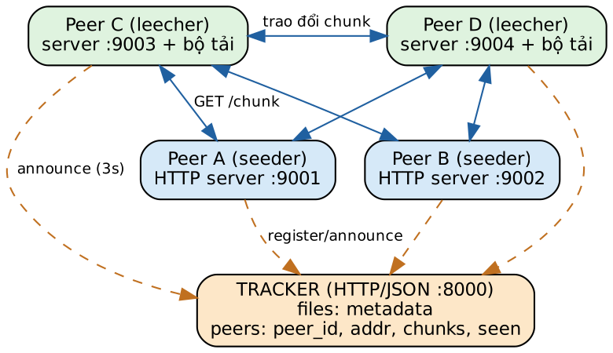
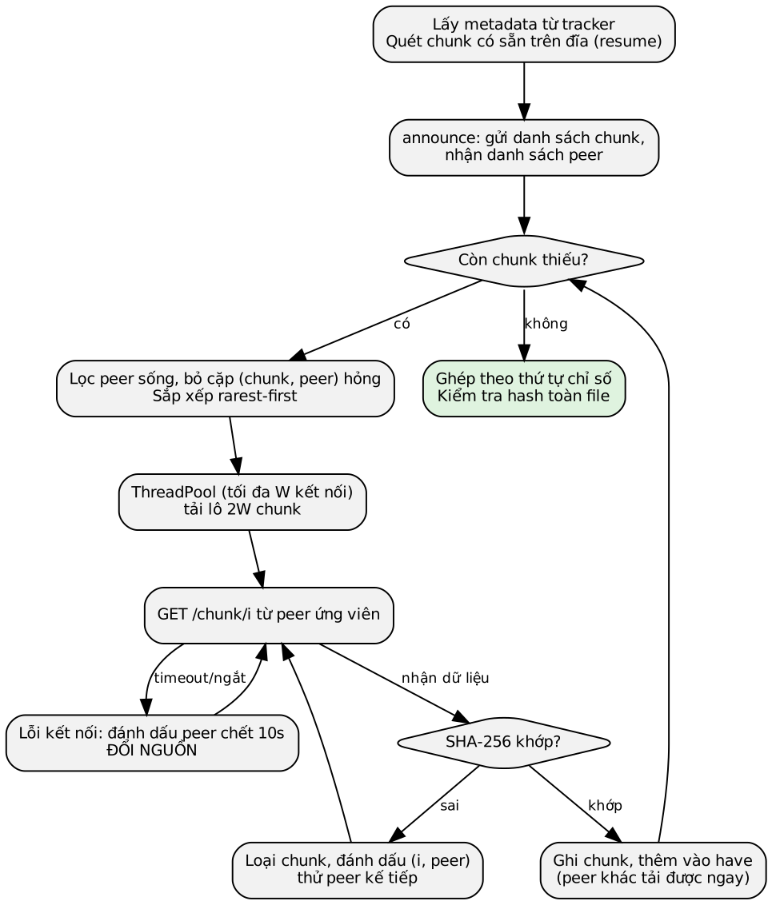
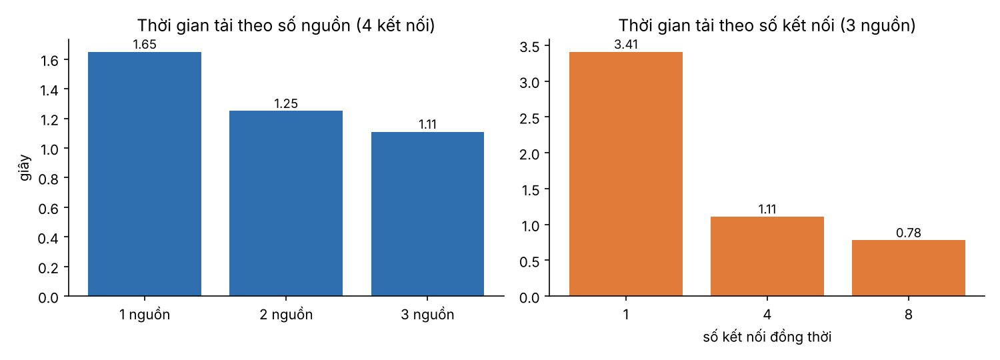

::: {custom-style="Center"}
HỌC VIỆN CÔNG NGHỆ BƯU CHÍNH VIỄN THÔNG

KHOA CÔNG NGHỆ THÔNG TIN

Giảng viên hướng dẫn: [Tên giảng viên]

Nhóm: [Số nhóm]

Nguyễn Lê Hoàng – B23DCVT172

Lê Anh Vũ – [MSSV]

Hà Nội, tháng 11 năm 2026
:::

# 1. Thông tin nhóm và phân công

| STT | Họ tên | MSSV | Công việc phụ trách |
|---|---|---|---|
| 1 | Nguyễn Lê Hoàng | B23DCVT172 | Thiết kế metadata và giao thức tracker; cài đặt `common.py`, `tracker.py`, xác thực API key; test chức năng và bảo mật; đo hiệu năng; báo cáo, slide, README |
| 2 | Lê Anh Vũ | [MSSV] | Cài đặt `peer.py` (upload, tải song song, đổi nguồn, rarest-first, resume); script demo; test đồng thời, lỗi và hiệu năng; Docker |

Hai thành viên cùng thống nhất định dạng metadata và các API của tracker ngay từ đầu. Nhờ vậy mỗi người phát triển và kiểm thử phần của mình độc lập, rồi ghép lại qua giao thức HTTP/JSON đã định trước. Mã nguồn được quản lý trên GitHub, mỗi thành viên commit bằng tài khoản của mình.

# 2. Tóm tắt

Nhóm em xây dựng một hệ thống chia sẻ file ngang hàng (P2P) mô phỏng cơ chế cốt lõi của BitTorrent. File được chia thành các chunk kích thước cố định 64 KB, mỗi chunk được băm bằng SHA-256 và ghi vào một file metadata. Tracker chỉ quản lý metadata và danh sách peer đang giữ từng chunk, hoàn toàn không lưu và không gửi nội dung file. Mỗi peer vừa là server (phục vụ các chunk mình đang có) vừa là client (tải song song các chunk còn thiếu từ nhiều peer khác, có giới hạn số kết nối đồng thời).

Hệ thống xử lý được các tình huống lỗi chính: peer nguồn rời mạng giữa chừng thì peer tải tự chuyển sang nguồn khác; peer gửi dữ liệu hỏng thì chunk bị phát hiện qua hash và bị loại; chương trình bị tắt thì khi chạy lại sẽ tải tiếp từ các chunk đã có trên đĩa; tracker khởi động lại thì các peer tự đăng ký lại metadata. Các tính năng nâng cao đã cài đặt gồm rarest-first, giới hạn băng thông upload, resume download và mô phỏng churn qua heartbeat/timeout. Mọi node xác thực nhau bằng khoá bí mật dùng chung đọc từ biến môi trường, dữ liệu vào được kiểm tra định dạng và giới hạn kích thước. Bộ 20 test tự động (8 chức năng, 2 đồng thời, 2 lỗi và phục hồi, 4 bảo mật, 1 hiệu năng, 3 test đơn vị) đều đạt.

Kết quả đo cho thấy với file 4 MB, thời gian tải giảm từ 1,65 s (1 nguồn) xuống 1,11 s (3 nguồn), và giảm từ 3,41 s (1 kết nối) xuống 0,78 s (8 kết nối). Thời gian phát hiện một nguồn bị tắt khoảng 0,08 s. Mọi lần tải đều cho hash toàn file khớp với file gốc.

Hệ thống được viết bằng Python 3, chỉ dùng thư viện chuẩn, chạy được dưới dạng nhiều tiến trình trên một máy, trên nhiều máy trong mạng, hoặc mỗi node một container Docker.

# 3. Mô tả bài toán và yêu cầu

## 3.1. Bài toán

Khi phân phối một file lớn cho nhiều người theo mô hình client–server, băng thông của server là nút thắt: càng nhiều người tải, mỗi người càng chậm, và server sập thì không ai tải được. Mô hình P2P như BitTorrent giải quyết bằng cách để chính những người đang tải chia sẻ lại phần mình đã có. Càng nhiều người tham gia thì tổng băng thông của hệ thống càng lớn.

Bài toán đặt ra là xây dựng một hệ thống cho phép:

- Chia file thành các chunk và tạo metadata mô tả file.
- Tracker quản lý metadata và danh sách peer có toàn bộ hoặc một phần file.
- Peer tải song song nhiều chunk từ nhiều peer khác, đồng thời phục vụ chunk cho người khác ngay cả khi chưa tải xong.
- Đảm bảo toàn vẹn dữ liệu và chịu được các lỗi thường gặp trong môi trường phân tán.

## 3.2. Yêu cầu chức năng

| Nhóm | Yêu cầu | Trạng thái |
|---|---|---|
| Metadata | File ID, tên và kích thước file, kích thước và số chunk, hash từng chunk, hash toàn file, thông tin tracker | Đã làm |
| Chia sẻ | Seeder chia file, đăng ký với tracker; tracker quản lý peer; peer thông báo danh sách chunk | Đã làm |
| Tải file | Tải từ ≥ 2 peer; tải song song nhiều chunk; vừa tải vừa upload; chunk lỗi tải lại từ peer khác; giới hạn số kết nối | Đã làm |
| Toàn vẹn | Kiểm tra hash từng chunk; loại chunk sai; ghép đúng thứ tự; kiểm tra hash toàn file | Đã làm |
| Phục hồi | Tiếp tục tải khi nguồn rời mạng; tải tiếp sau khi khởi động lại | Đã làm |

## 3.3. Yêu cầu phi chức năng

- **Ràng buộc kiến trúc:** tracker không được cung cấp nội dung file.
- **Hiệu năng:** thời gian tải giảm khi có nhiều nguồn và nhiều kết nối.
- **Khả năng mở rộng:** thêm peer không cần cấu hình lại hệ thống.
- **Tính sẵn sàng:** một peer nguồn hỏng không làm gián đoạn việc tải nếu chunk còn ở peer khác.
- **Dễ triển khai:** không phụ thuộc thư viện ngoài, chạy được trên Windows, Linux và Docker.

# 4. Các vấn đề của hệ thống phân tán

Đề tài này đặt ra các vấn đề điển hình của hệ phân tán:

1. **Định danh và khám phá (naming & discovery):** làm sao một peer biết file nào tồn tại và peer nào đang giữ chunk nào khi không có danh bạ cố định.
2. **Truyền thông (communication):** chọn giao thức trao đổi metadata, danh sách peer và dữ liệu nhị phân.
3. **Đồng thời (concurrency):** một peer cùng lúc tải nhiều chunk và phục vụ nhiều yêu cầu; tập chunk đang có bị đọc và ghi bởi nhiều luồng.
4. **Nhất quán (consistency):** danh sách chunk của mỗi peer thay đổi liên tục, thông tin ở tracker luôn có thể cũ.
5. **Chịu lỗi (fault tolerance):** peer có thể rời mạng bất kỳ lúc nào (churn), mạng có thể ngắt hoặc chậm, peer có thể gửi dữ liệu hỏng, tracker có thể khởi động lại.
6. **Bảo mật và toàn vẹn:** dữ liệu nhận từ peer lạ không đáng tin, phải kiểm chứng được.
7. **Hiệu năng và mở rộng:** phân tải đều giữa các nguồn, tránh tình trạng chunk hiếm biến mất khỏi mạng.

# 5. Phân tích và lựa chọn giải pháp

| Vấn đề | Phương án cân nhắc | Lựa chọn và lý do |
|---|---|---|
| Khám phá peer | Tracker tập trung / DHT | **Tracker**: đơn giản, đúng yêu cầu tối thiểu, dễ quan sát khi demo. DHT để làm hướng phát triển |
| Giao thức | TCP socket tự định nghĩa / HTTP | **HTTP/1.1 trên TCP**: có sẵn framing (Content-Length), mã trạng thái lỗi (404), dễ debug bằng trình duyệt hoặc curl |
| Định dạng điều khiển | Nhị phân / JSON | **JSON**: dễ đọc, dễ kiểm thử; lượng dữ liệu điều khiển nhỏ |
| Kiểm tra toàn vẹn | CRC32 / MD5 / SHA-256 | **SHA-256**: chống va chạm tốt, không làm giả được như CRC; có sẵn trong `hashlib` |
| Kích thước chunk | 16 KB / 64 KB / 256 KB / 1 MB | **64 KB**: với file vài MB vẫn có hàng chục chunk để thấy rõ tải song song; metadata nhỏ |
| Mô hình đồng thời | asyncio / thread | **Thread** (`ThreadingHTTPServer`, `ThreadPoolExecutor`): mã tuần tự dễ hiểu; I/O mạng giải phóng GIL nên song song thực sự |
| Phát hiện peer chết | Ping riêng / heartbeat qua announce | **Heartbeat qua announce mỗi 3 s, timeout 10 s**: một thông điệp vừa báo sống vừa cập nhật danh sách chunk |
| Chọn chunk | Tuần tự / ngẫu nhiên / rarest-first | **Rarest-first** kèm ngẫu nhiên khi bằng nhau: giữ chunk hiếm không bị mất, phân tải đều |

Ngôn ngữ Python được chọn vì thư viện chuẩn đã có đủ HTTP server/client, thread pool và băm. Toàn bộ hệ thống khoảng 400 dòng nên dễ đọc và giải thích.

# 6. Kiến trúc hệ thống

{width=95%}

Hệ thống gồm 2 loại node:

- **Tracker:** một tiến trình HTTP server giữ hai bảng trong bộ nhớ: `files[file_id] = metadata` và `peers[file_id][peer_id] = {addr, chunks, seen}`. Tracker là "danh bạ": nó cho biết ai có gì nhưng không tham gia truyền dữ liệu.
- **Peer:** mỗi peer là một tiến trình gồm 3 phần chạy song song:
  - **Server upload:** HTTP server đa luồng, trả về chunk qua `GET /chunk/<file_id>/<i>`.
  - **Luồng heartbeat:** cứ 3 giây gửi `announce` lên tracker.
  - **Bộ tải:** thread pool tải các chunk còn thiếu (chỉ có khi chạy chế độ `get`).

Peer chạy ở chế độ `seed` (có sẵn toàn bộ file) hoặc `get` (tải về, sau khi tải xong tiếp tục seed). Một peer đang tải vẫn là nguồn cho peer khác với những chunk đã có, đây chính là điểm khác biệt cốt lõi so với client–server.

**Luồng dữ liệu:** dữ liệu điều khiển (metadata, danh sách peer) đi qua tracker; dữ liệu file chỉ đi trực tiếp giữa các peer. Vì vậy tracker đáp ứng ràng buộc "không cung cấp nội dung file" ngay từ thiết kế.

**Triển khai:** mỗi node là một tiến trình độc lập có cổng riêng, giao tiếp qua mạng. Có thể chạy cả hệ thống trên một máy (`scripts/demo.py`), trên nhiều máy (dùng tham số `--host`, `--tracker`), hoặc trong Docker, mỗi node một container trên mạng `p2p` (`deploy/docker-compose.yml`).

# 7. Thiết kế thành phần và giao thức

## 7.1. Metadata

Metadata được sinh bởi hàm `make_meta()` khi seeder đọc file theo từng khối 64 KB:

```json
{
  "file_id": "0d4ce0251f18302b",
  "name": "video.bin",
  "size": 4194304,
  "chunk_size": 65536,
  "num_chunks": 64,
  "chunk_hashes": ["9f2c...", "a71b...", "..."],
  "file_hash": "0d4ce0251f18302b6e...",
  "tracker": "http://127.0.0.1:8000"
}
```

`file_id` lấy 16 ký tự đầu của hash toàn file. Như vậy hai seeder chia sẻ cùng một nội dung sẽ có cùng `file_id` và cùng một "swarm" mà không cần phối hợp.

## 7.2. API của tracker

| Phương thức | Đường dẫn | Dữ liệu gửi | Phản hồi |
|---|---|---|---|
| POST | `/register` | metadata | `{"ok": true}`; 400 nếu metadata sai định dạng |
| POST | `/announce` | `file_id, peer_id, addr, chunks[]` | `{"peers": [{peer_id, addr, chunks}]}`; 404 nếu file chưa đăng ký |
| POST | `/leave` | `file_id, peer_id` | `{"ok": true}` |
| GET | `/meta/<file_id>` | – | metadata |
| GET | `/peers/<file_id>` | – | danh sách peer |
| GET | `/files` | – | các file đang chia sẻ và số peer |

Mọi API của tracker yêu cầu header `X-API-Key`; sai hoặc thiếu trả 401, request lớn hơn 1 MB trả 413.

## 7.3. API của peer

| Phương thức | Đường dẫn | Header | Phản hồi |
|---|---|---|---|
| GET | `/chunk/<file_id>/<i>` | `X-API-Key` (xác thực), `X-Peer-Id` (để ghi log) | 200 kèm byte của chunk; 401 nếu sai khoá; 404 nếu chưa có chunk hoặc sai `file_id` |

## 7.4. Trình tự chia sẻ và tải

1. Seeder A: `make_meta` → chia file thành `0.chunk ... 63.chunk` → `POST /register` → `POST /announce` với đủ 64 chunk.
2. Peer C: `GET /meta/<file_id>` → quét đĩa xem đã có chunk nào → `POST /announce` với các chunk đang có → nhận danh sách peer cùng chunk của từng peer.
3. C chọn chunk theo rarest-first và gọi `GET /chunk/<file_id>/<i>` song song tới các peer.
4. Mỗi chunk nhận về được kiểm tra SHA-256 rồi ghi xuống đĩa và thêm vào tập `have`. Từ lúc đó C phục vụ được chunk này cho peer khác.
5. Khi đủ chunk, C ghép file theo thứ tự chỉ số, kiểm tra hash toàn file, rồi tiếp tục seed.

{width=92%}

## 7.5. Thông điệp trùng lặp và sai thứ tự

- **announce là idempotent:** mỗi lần announce gửi toàn bộ danh sách chunk hiện có và *ghi đè* bản ghi cũ của peer, nên announce bị gửi lặp hay đến trễ cũng không làm sai trạng thái. Bản ghi mới nhất luôn thắng.
- **Tải trùng chunk vô hại:** nếu cùng một chunk được tải hai lần (do thử lại), file chunk được ghi đè bằng đúng nội dung đã kiểm tra hash, và `have` là tập hợp nên không bị đếm trùng.
- **Không phụ thuộc thứ tự đến:** các chunk về theo thứ tự bất kỳ, mỗi chunk lưu theo chỉ số của nó. Chỉ khi đủ chunk mới ghép theo thứ tự 0..n-1.
- **Retry có giới hạn theo nguồn:** một chunk được thử lần lượt qua các nguồn hiện có; nguồn lỗi bị bỏ qua 10 s; không còn nguồn thì chờ 2 s rồi lập kế hoạch lại.

## 7.6. Lưu trữ trên đĩa

Mỗi peer có thư mục `data/<peer_id>/<file_id>/` chứa `meta.json` và các file `i.chunk`. Mỗi chunk lưu thành file riêng nên các luồng ghi song song không đụng nhau, và việc tải tiếp chỉ cần quét thư mục rồi kiểm tra hash.

# 8. Định danh và khám phá

- **Định danh file:** `file_id` sinh từ nội dung (content addressing). Cùng nội dung thì cùng định danh, nội dung khác thì gần như chắc chắn khác định danh.
- **Định danh chunk:** cặp `(file_id, chỉ số i)`. Hash trong metadata giúp chunk tự kiểm chứng được, không phụ thuộc nguồn gửi.
- **Định danh peer:** `peer_id` do người chạy đặt (`--id`), kèm địa chỉ liên lạc `addr = http://<host>:<port>`. Tham số `--host` cho phép peer quảng bá địa chỉ mà peer khác truy cập được (IP LAN hoặc tên container Docker), tách biệt với địa chỉ lắng nghe `0.0.0.0`.
- **Khám phá:** tracker là điểm khởi đầu (bootstrap). Peer biết được peer khác và các chunk họ có qua phản hồi của `announce`. Vì announce lặp lại mỗi 3 giây, peer mới tham gia sẽ được các peer khác "thấy" trong vòng 3 giây.
- **Rời mạng:** peer thoát bình thường gửi `/leave`; peer chết đột ngột bị tracker xoá sau 10 giây không có heartbeat (log `TIMEOUT peer ...`).

# 9. Đồng thời, đồng bộ và nhất quán

## 9.1. Các luồng đồng thời trong một peer

| Luồng | Số lượng | Công việc |
|---|---|---|
| Luồng chính | 1 | Vòng lặp lập kế hoạch tải |
| Thread pool tải | `--workers` (mặc định 4) | Mỗi luồng tải 1 chunk tại một thời điểm |
| Luồng HTTP server | 1 luồng cho mỗi yêu cầu | Phục vụ upload |
| Luồng heartbeat | 1 | announce mỗi 3 s |

## 9.2. Đồng bộ

- **Tập `have`** (chunk đang có) được đọc bởi luồng upload và luồng heartbeat, được ghi bởi luồng tải. Mọi thao tác đọc/ghi đều đặt trong `threading.Lock`. Khi announce, peer chụp một bản sao đã sắp xếp của `have` trong lock rồi mới gửi đi, nên không giữ lock trong lúc chờ mạng.
- **Bộ đếm thống kê** `stats` cũng được cập nhật trong cùng lock.
- **Ghi file chunk:** mỗi chunk một file riêng. Chunk được ghi xong xuống đĩa *rồi* mới thêm vào `have`, nên luồng upload không bao giờ đọc phải file đang ghi dở.
- **Tracker:** `ThreadingHTTPServer` xử lý nhiều peer cùng lúc. Toàn bộ thao tác trên `files` và `peers` nằm trong một lock toàn cục, đảm bảo mỗi yêu cầu thấy trạng thái nhất quán.

## 9.3. Giới hạn đồng thời

- **Phía tải:** `ThreadPoolExecutor(max_workers=W)` giới hạn tối đa W kết nối tải cùng lúc. Mỗi vòng lấy một lô 2W chunk để luôn đủ việc cho các luồng.
- **Phía upload:** `threading.Semaphore(--upload-slots)` giới hạn số lượt gửi đồng thời. Cơ chế này mô phỏng băng thông upload có hạn và tránh một peer bị quá tải.

## 9.4. Nhất quán

Danh sách chunk ở tracker là **trạng thái mềm (soft state)**, nhất quán cuối cùng (eventual consistency): nó có thể cũ tối đa khoảng 3 giây, hoặc tối đa 10 giây với peer đã chết. Nhóm em chấp nhận điều này vì tính đúng đắn của dữ liệu không phụ thuộc vào tracker:

- Nếu tracker nói peer X có chunk i nhưng X chưa có hoặc đã chết, yêu cầu sẽ nhận 404 hoặc lỗi kết nối, và peer tải thử nguồn khác.
- Nội dung chunk luôn được kiểm tra bằng hash trong metadata, nên mọi bản sao nhận được đều giống nhau.

Nói cách khác, hệ thống dùng **nhất quán lỏng cho metadata điều phối** và **đảm bảo chặt cho dữ liệu** bằng hash. Metadata là bất biến (immutable) sau khi tạo nên không cần đồng bộ bản cập nhật.

## 9.5. Chiến lược chọn chunk: rarest-first

Ở mỗi vòng, peer đếm số peer đang giữ mỗi chunk còn thiếu, xáo trộn ngẫu nhiên rồi sắp xếp tăng dần theo số người giữ. Chunk hiếm nhất được tải trước. Danh sách nguồn của mỗi chunk cũng được xáo trộn để tải được chia đều cho các nguồn. Kết quả demo cho thấy peer C nhận chunk từ cả A, B và D.

# 10. Chịu lỗi và phục hồi

## 10.1. Mô hình lỗi

| Loại lỗi | Mô tả | Ví dụ trong hệ thống |
|---|---|---|
| Crash-stop | Node dừng hẳn, không gửi gì nữa | Seeder B bị kill giữa chừng |
| Omission / timing | Mất kết nối, phản hồi quá chậm | Timeout 5 s khi tải chunk |
| Lỗi dữ liệu (Byzantine giới hạn) | Peer gửi dữ liệu sai | B chạy với `--corrupt` |
| Khởi động lại | Tiến trình tắt rồi chạy lại | Peer E bị tắt và chạy lại; tracker khởi động lại |

Hệ thống không chống được peer độc hại có chủ đích ở tầng điều phối, ví dụ khai gian danh sách chunk. Tuy nhiên peer này không thể làm hỏng dữ liệu vì mọi chunk đều được kiểm tra hash.

## 10.2. Cơ chế xử lý

1. **Phát hiện nguồn chết:** khi kết nối bị từ chối, bị ngắt hoặc quá 5 s, peer tải đánh dấu nguồn đó "chết" trong 10 giây (`dead[peer_id]`) và lập tức thử nguồn kế tiếp cho cùng chunk (log `DOI NGUON`). Sau 10 giây nguồn được thử lại, phòng khi peer quay lại mạng.
2. **Phát hiện chunk hỏng:** chunk sai SHA-256 bị loại, không ghi xuống đĩa. Cặp `(chunk, peer)` bị đưa vào danh sách đen để không xin lại chunk đó từ peer đó, rồi chunk được tải lại từ peer khác (log `CHUNK KHONG HOP LE`).
3. **Tracker phát hiện peer chết:** peer không gửi heartbeat quá 10 giây bị xoá khỏi danh sách, nên peer mới không bị trỏ tới nguồn chết.
4. **Khi tạm thời không có nguồn:** nếu không peer nào giữ chunk còn thiếu, peer chờ 2 giây rồi announce lại, không bỏ cuộc. Khi có nguồn mới thì tải tiếp.
5. **Tải tiếp sau khi khởi động lại:** chunk đã nằm trên đĩa. Lúc khởi động, peer kiểm tra lại hash từng file chunk và chỉ tải phần còn thiếu (log `TIEP TUC TAI: da co san 30/64 chunk`). Chunk ghi dở bị hỏng sẽ không qua được kiểm tra hash nên được tải lại.
6. **Tracker khởi động lại:** tracker giữ trạng thái trong RAM nên khởi động lại là mất. Khi announce nhận 404, peer tự gửi lại `/register` với metadata nó đang giữ. Bất kỳ peer nào có metadata cũng khôi phục được thông tin cho tracker. Trong lúc tracker sập, peer vẫn tải tiếp với danh sách peer đã biết từ lần announce trước.

## 10.3. Điểm lỗi đơn

Tracker là điểm lỗi đơn cho việc **khám phá peer mới**, nhưng không phải cho việc **truyền dữ liệu**: các peer đã biết nhau vẫn trao đổi chunk bình thường khi tracker sập. Hướng khắc phục triệt để là tracker nhân bản hoặc DHT (mục 15).

# 11. Bảo mật

## 11.1. Các biện pháp đã cài đặt

| Yêu cầu (mục 4.5 của đề) | Cách nhóm em làm | Vị trí trong mã |
|---|---|---|
| Xác thực peer và dịch vụ | Mọi request tới tracker và tới peer phải có header `X-API-Key` khớp khoá bí mật dùng chung của swarm. Sai hoặc thiếu trả 401. So sánh bằng `hmac.compare_digest` (thời gian hằng số, không lộ thông tin qua thời gian phản hồi) | `tracker.py` hàm `authed`; `peer.py` đầu `do_GET` |
| Kiểm soát truy cập tài nguyên | Peer chỉ trả chunk thuộc `file_id` đang chia sẻ và có trong `have`; chỉ số chunk phải là số nguyên | `peer.py`, `do_GET` |
| Kiểm tra và làm sạch dữ liệu vào | Metadata: hash đúng 64 ký tự hex, số hash khớp `num_chunks`, `file_id` đúng định dạng. Announce: `peer_id` chỉ gồm chữ, số, `-`, `_` (tối đa 32 ký tự), `addr` phải là `http://`, chỉ số chunk trong phạm vi. Sai thì trả 400 | `tracker.py`, `valid_meta`, `do_POST` |
| Không lưu mật khẩu dạng rõ, không commit bí mật | Hệ thống không có mật khẩu người dùng. Khoá API đọc từ biến môi trường hoặc file `.env` (đã có trong `.gitignore`); repo chỉ chứa `.env.example` với giá trị mẫu | `common.py`, `load_env` |
| Giới hạn kích thước | Request JSON tối đa 1 MB (413); `chunk_size` tối đa 4 MB; khi tải, peer chỉ đọc tối đa `chunk_size + 1` byte và loại chunk dài hơn | `common.py` (`MAX_BODY`, `MAX_CHUNK`), `tracker.py`, `peer.py` |
| Ghi log hoạt động quan trọng | Log REGISTER, JOIN, LEAVE, TIMEOUT, AUTH tu choi (chỉ ghi địa chỉ, không ghi giá trị khoá), CHUNK KHONG HOP LE, DOI NGUON | Toàn bộ |
| Toàn vẹn dữ liệu | SHA-256 từng chunk và toàn file | `peer.py`, `get_chunk`, `merge` |

## 11.2. Hạn chế

- Khoá dùng chung cho cả swarm: ai có khoá đều tham gia được, chưa phân biệt quyền từng peer.
- Chưa mã hoá đường truyền (chưa dùng TLS) nên khoá có thể bị nghe lén trong mạng không tin cậy.
- Vẫn tin tưởng metadata do tracker cung cấp.

Hướng tăng cường: HTTPS/TLS giữa các node, khoá riêng cho từng peer, ký metadata bằng khoá riêng của seeder.

# 12. Cài đặt

## 12.1. Môi trường và cấu trúc mã nguồn

Python ≥ 3.8, chỉ dùng thư viện chuẩn (`http.server`, `urllib`, `hashlib`, `threading`, `concurrent.futures`, `argparse`, `logging`).

| File | Số dòng (xấp xỉ) | Nội dung |
|---|---|---|
| `src/common.py` | 66 | `load_env`, `sha`, `read`, `make_meta`, `http_json`, `log_setup`; hằng số giới hạn kích thước |
| `src/tracker.py` | 126 | Handler HTTP, `authed`, `valid_meta`, `prune`, `plist`, lock toàn cục |
| `src/peer.py` | 240 | Lớp `Peer`: `setup`, `split`, `serve`, `announce`, `heartbeat`, `get_chunk`, `download`, `merge` |
| `scripts/demo.py` | 100 | Chạy tự động các kịch bản bắt buộc |
| `scripts/benchmark.py` | 80 | Đo hiệu năng |
| `tests/` | 360 | 20 test tự động, `helpers.py` dựng cụm tracker + peer thật |
| `deploy/` | – | Dockerfile, docker-compose (tracker, 2 seeder, 2 peer) |

## 12.2. Đoạn mã cốt lõi: tải một chunk và đổi nguồn

```python
def get_chunk(s, i, cands):
    for p in cands:                      # thử lần lượt các peer có chunk i
        pid = p["peer_id"]
        if not s.alive(pid) or (i, pid) in s.bad:
            continue
        try:
            data = fetch(p, i)           # GET /chunk/<file_id>/<i>, timeout 5s
        except Exception:
            s.dead[pid] = time.time()    # đánh dấu nguồn chết -> ĐỔI NGUỒN
            continue
        if sha(data) != s.meta["chunk_hashes"][i]:
            s.bad.add((i, pid))          # chunk hỏng -> loại, thử peer khác
            continue
        write_chunk(i, data)             # ghi xong mới thêm vào have
        with s.lock:
            s.have.add(i)
        return True
    return False
```

## 12.3. Đoạn mã cốt lõi: lập kế hoạch tải với rarest-first

```python
holders = {i: [p for p, c in owned if i in c and (i, p["peer_id"]) not in s.bad]
           for i in missing}
avail = [i for i in missing if holders[i]]
random.shuffle(avail)
avail.sort(key=lambda i: len(holders[i]))   # chunk hiếm nhất tải trước
batch = avail[: s.a.workers * 2]
pool.map(lambda i: s.get_chunk(i, random.sample(holders[i], len(holders[i]))), batch)
```

## 12.4. Cách chạy

```bash
python scripts/demo.py                       # toàn bộ kịch bản demo
python -m unittest discover tests            # test đơn vị
python scripts/benchmark.py                  # đo hiệu năng
docker compose -f deploy/docker-compose.yml up --build
```

Hướng dẫn chi tiết từng lệnh và tham số có trong `README.md`.

# 13. Kiểm thử và kết quả

## 13.1. Bộ test tự động

Chạy bằng `python -m unittest discover tests -v` (khoảng 25 giây). Ngoài 3 test đơn vị, các test còn lại đều dựng tracker và peer **thật**: mỗi node là một tiến trình riêng, cổng ngẫu nhiên, giao tiếp qua mạng (`tests/helpers.py`). Bộ test đã chạy 6 lần liên tiếp đều đạt toàn bộ.

| Nhóm (mục 9 của đề) | Test | Nội dung kiểm tra | Kết quả |
|---|---|---|---|
| Chức năng (8) | F1 | Metadata có đủ 8 trường, số chunk đúng | Đạt |
| | F2 | Đăng ký metadata rồi lấy lại đúng nguyên vẹn | Đạt |
| | F3 | Announce trả về danh sách peer | Đạt |
| | F4 | Leave xoá peer khỏi danh sách | Đạt |
| | F5 | Tải từ 1 nguồn, hash toàn file khớp | Đạt |
| | F6 | Tải song song từ 2 nguồn, log có chunk từ cả A và B | Đạt |
| | F7 | Peer gửi chunk cho peer khác khi chưa tải xong | Đạt |
| | F8 | Tắt peer giữa chừng, chạy lại thì tải tiếp, file đúng | Đạt |
| Đồng thời (2) | C1 | 30 peer announce cùng lúc, tracker ghi nhận đủ 30, không lỗi | Đạt |
| | C2 | 2 peer tải đồng thời, trao đổi chunk cho nhau, trạng thái cuối cả hai đều có file đúng | Đạt |
| Lỗi và phục hồi (2) | R1 | Tắt nguồn B khi C đang tải: C ghi `DOI NGUON` và vẫn hoàn tất | Đạt |
| | R2 | Tracker khởi động lại: seeder tự đăng ký lại metadata, peer mới tải được | Đạt |
| Bảo mật, dữ liệu sai (4) | S1 | Thiếu hoặc sai `X-API-Key` → 401 ở cả tracker và peer; tracker ghi log `AUTH tu choi` | Đạt |
| | S2 | JSON hỏng, metadata sai hash, `peer_id` chứa `../` → 400; request khai báo 2 MB → 413 | Đạt |
| | S3 | Peer gửi chunk hỏng: chunk bị loại, file cuối vẫn đúng | Đạt |
| | S4 | Chỉ số chunk ngoài phạm vi, số âm, đường dẫn `../`, sai `file_id` → 404 | Đạt |
| Hiệu năng (1) | P1 | 3 nguồn tải nhanh hơn 1 nguồn (mỗi nguồn 1 lượt upload) | Đạt |
| Đơn vị (3) | – | Tạo metadata, phát hiện byte bị sửa, phân tích chuỗi `0-2,7` | Đạt |

Thí nghiệm hiệu năng đầy đủ ở mục 14.

## 13.2. Kiểm thử tích hợp theo kịch bản bắt buộc

Kịch bản trong `scripts/demo.py`: 1 tracker; seeder A (bình thường); seeder B gửi hỏng chunk 0–15; peer C và D tải đồng thời file 4 MB (64 chunk); sau 2 giây tắt đột ngột B; peer E tải, bị tắt giữa chừng rồi chạy lại.

| # | Kịch bản | Kết quả quan sát | Đạt |
|---|---|---|---|
| 1 | Tạo metadata, chia sẻ file | Tracker log `REGISTER file 0d4ce0251f18302b (video.bin, 64 chunk)` | ✓ |
| 2 | Tải song song từ ≥ 2 peer | C nhận chunk từ A (40), B (14), D (10) | ✓ |
| 3 | Upload khi chưa tải xong | 22–25 lượt upload khi peer chưa đủ 64 chunk, ví dụ `UPLOAD chunk 5 -> D (minh dang co 36/64)` | ✓ |
| 4 | Tắt một nguồn khi đang tải | `LOI tai chunk 4 tu B (RemoteDisconnected) -> danh dau peer loi, DOI NGUON` | ✓ |
| 5 | Chuyển sang nguồn khác | Các chunk sau đó được tải từ A và D, C hoàn tất 64/64 | ✓ |
| 6 | Phát hiện chunk hỏng | C phát hiện 3–5 chunk sai SHA-256 từ B, loại bỏ và tải lại | ✓ |
| 7 | Ghép file, kiểm tra hash | `GHEP FILE ... HASH TOAN FILE KHOP` ở C, D, E; so sánh với file gốc khớp | ✓ |
| 8 | Tải tiếp sau khởi động lại | E lần 2: `TIEP TUC TAI: da co san 30/64 chunk tren dia` | ✓ |
| 9 | Tracker khởi động lại | Seeder log `DANG KY LAI metadata`, peer mới vẫn tải thành công | ✓ |
| 10 | Tracker không giữ nội dung | Tracker không có API trả dữ liệu file, chỉ có metadata và peer | ✓ |

## 13.3. Trích log minh hoạ (peer C)

```
09:24:51.631 [C] ERROR CHUNK KHONG HOP LE 12 tu B: sai SHA-256 -> loai bo, tai lai tu peer khac
09:24:53.084 [C] WARNING LOI tai chunk 4 tu B (RemoteDisconnected) -> danh dau peer loi, DOI NGUON
09:24:53.236 [C] INFO UPLOAD chunk 5 -> D (minh dang co 36/64)
09:24:54.184 [C] INFO Tai xong 64 chunk trong 3.02s. Nguon: {'B': 14, 'A': 40, 'D': 10}
09:24:54.206 [C] INFO GHEP FILE .../C/video.bin -> HASH TOAN FILE KHOP (0d4ce0251f18302b...)
```

# 14. Đánh giá hiệu năng

**Thiết lập:** file 4 MB, chunk 64 KB (64 chunk). Để mô phỏng băng thông hữu hạn, mỗi lượt upload trễ 50 ms và mỗi seeder phục vụ tối đa 2 lượt upload cùng lúc. Toàn bộ chạy trên một máy, mỗi node là một tiến trình riêng. Số liệu lấy từ `scripts/benchmark.py`.

| Kịch bản | Số nguồn | Số kết nối | Thời gian tải (s) | Tốc độ (MB/s) | Hash cuối | Phát hiện lỗi (s) |
|---|---|---|---|---|---|---|
| 1 nguồn | 1 | 4 | 1,65 | 2,42 | Khớp | |
| 2 nguồn | 2 | 4 | 1,25 | 3,20 | Khớp | |
| 3 nguồn | 3 | 4 | 1,11 | 3,60 | Khớp | |
| 3 nguồn, 1 kết nối | 3 | 1 | 3,41 | 1,17 | Khớp | |
| 3 nguồn, 8 kết nối | 3 | 8 | 0,78 | 5,13 | Khớp | |
| 3 nguồn, tắt 1 nguồn sau 0,3 s | 3 | 4 | 1,26 | 3,17 | Khớp | 0,083 |

{width=95%}

**Nhận xét:**

- **Theo số nguồn:** từ 1 lên 3 nguồn, thời gian giảm 33%. Khi chỉ có 1 nguồn, băng thông upload của nó (2 lượt cùng lúc) là nút thắt. Thêm nguồn thì tổng băng thông tăng, đúng lợi thế của P2P. Mức giảm không tuyến tính vì phía tải chỉ có 4 kết nối, và mỗi vòng phải chờ cả lô hoàn tất.
- **Theo số kết nối:** từ 1 lên 8 kết nối, thời gian giảm 4,4 lần, cho thấy tải song song nhiều chunk là yếu tố quyết định tốc độ. Tuy nhiên nhiều kết nối hơn cũng tốn tài nguyên và gây áp lực lên nguồn, nên cần giới hạn.
- **Khi có lỗi:** tắt 1 trong 3 nguồn chỉ làm thời gian tăng từ 1,11 s lên 1,26 s (+14%). Lỗi được phát hiện sau khoảng 83 ms, vì lỗi kết nối được báo ngay chứ không phải chờ hết timeout. Với trường hợp nguồn treo mà không đóng kết nối, thời gian phát hiện tối đa bằng timeout 5 s. Tracker phát hiện peer chết sau tối đa 10 s.
- **Độ chính xác:** 100% lần tải có hash toàn file khớp, kể cả khi có peer gửi dữ liệu hỏng.

# 15. Hạn chế và hướng phát triển

**Hạn chế:**

- Tracker là điểm lỗi đơn cho việc khám phá peer, và giữ trạng thái trong RAM (đã giảm nhẹ bằng cơ chế đăng ký lại metadata).
- Chưa mã hoá đường truyền; xác thực mới dùng một khoá chung cho cả swarm.
- Lập kế hoạch theo lô nên luồng nhanh phải chờ luồng chậm cuối lô.
- Chưa có choking/tit-for-tat nên peer "ăn bám" (chỉ tải không gửi) vẫn được phục vụ.
- Mỗi peer chỉ quản lý một file tại một thời điểm.
- Thử nghiệm mới chạy trên một máy, chưa đo trên mạng thật có độ trễ cao.

**Hướng phát triển:**

- Tracker nhân bản (nhiều tracker đồng bộ trạng thái) hoặc DHT kiểu Kademlia để bỏ điểm lỗi đơn.
- Magnet link: chỉ cần `file_id` là lấy được metadata từ các peer.
- Choking/unchoking, tit-for-tat để khuyến khích chia sẻ.
- Lập lịch liên tục (hàng đợi việc) thay cho lập lịch theo lô.
- TLS, khoá riêng cho từng peer và chữ ký số cho metadata.
- Giao diện web hiển thị tiến độ và bản đồ chunk của từng peer.

# 16. Kết luận

Nhóm em đã xây dựng hoàn chỉnh một hệ thống chia sẻ file P2P mô phỏng BitTorrent. Hệ thống đáp ứng toàn bộ yêu cầu chức năng và cả 7 kịch bản demo bắt buộc của đề, cùng các tính năng nâng cao: rarest-first, giới hạn băng thông, resume download và mô phỏng churn, có xác thực và bộ 20 test tự động theo đủ các nhóm yêu cầu. Qua đề tài, nhóm em hiểu rõ hơn các vấn đề cốt lõi của hệ phân tán: khám phá node qua bootstrap server, chấp nhận trạng thái điều phối nhất quán cuối cùng trong khi vẫn đảm bảo dữ liệu đúng tuyệt đối bằng hash, xử lý đồng thời bằng khoá và giới hạn tài nguyên, phát hiện lỗi bằng timeout và heartbeat, và phục hồi bằng cách lưu trạng thái bền vững trên đĩa. Kết quả đo xác nhận lợi ích của mô hình P2P: thêm nguồn và thêm kết nối song song làm tăng tốc độ tải, còn một nguồn hỏng chỉ ảnh hưởng nhỏ tới thời gian hoàn tất.

# 17. Tài liệu tham khảo

1. B. Cohen, "Incentives Build Robustness in BitTorrent," *Workshop on Economics of Peer-to-Peer Systems*, 2003.
2. BitTorrent.org, "BEP 3: The BitTorrent Protocol Specification," https://www.bittorrent.org/beps/bep_0003.html
3. P. Maymounkov, D. Mazières, "Kademlia: A Peer-to-peer Information System Based on the XOR Metric," *IPTPS*, 2002.
4. A. S. Tanenbaum, M. van Steen, *Distributed Systems*, 4th ed., 2023.
5. NIST, "FIPS 180-4: Secure Hash Standard (SHS)," 2015.
6. Python Software Foundation, tài liệu `http.server`, `concurrent.futures`, `hashlib`, https://docs.python.org/3/
7. Học viện Công nghệ Bưu chính Viễn thông, *Course Project Specification – Distributed Systems*, 2026.

# 18. Phụ lục

## Phụ lục A. Bảng tham số dòng lệnh của peer

| Tham số | Mặc định | Ý nghĩa |
|---|---|---|
| `mode` | – | `seed` (chia sẻ file) hoặc `get` (tải về) |
| `target` | – | Đường dẫn file (seed) hoặc `file_id` (get) |
| `--id`, `--port` | – | Định danh và cổng của peer |
| `--host` | `127.0.0.1` | Địa chỉ peer khác dùng để kết nối tới |
| `--tracker` | `http://127.0.0.1:8000` | Địa chỉ tracker |
| `--workers` | 4 | Số kết nối tải đồng thời tối đa |
| `--upload-slots` | 4 | Số lượt upload đồng thời tối đa |
| `--chunk-kb` | 64 | Kích thước chunk |
| `--slow` | 0 | Độ trễ mỗi lượt upload (giây) |
| `--corrupt` | – | Danh sách chunk gửi hỏng (giả lập lỗi) |
| `--exit-when-done` | tắt | Tải xong thì thoát |

## Phụ lục B. Hằng số cấu hình

| Hằng số | Giá trị | Vị trí |
|---|---|---|
| Chu kỳ heartbeat | 3 s | `peer.py`, `heartbeat()` |
| Timeout peer ở tracker | 10 s | `tracker.py`, `PEER_TIMEOUT` |
| Thời gian bỏ qua peer lỗi | 10 s | `peer.py`, `DEAD_TTL` |
| Timeout tải một chunk | 5 s | `peer.py`, `get_chunk()` |
| Chờ khi không có nguồn | 2 s | `peer.py`, `download()` |

## Phụ lục C. Khai báo sử dụng AI

Nhóm em có sử dụng công cụ AI để hỗ trợ viết mã và soạn tài liệu. Toàn bộ mã đã được nhóm chạy thử, đọc hiểu, kiểm chứng bằng các kịch bản ở mục 13 và chịu trách nhiệm về kết quả.
